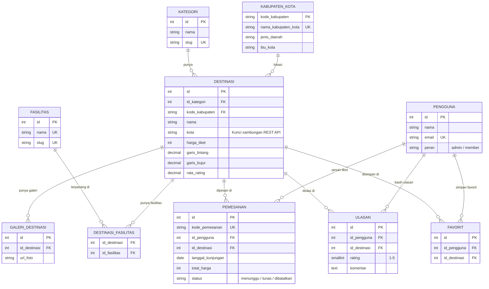

# 🎒 JejakSumut — Jelajahi Pesona Sumatera Utara
**Repo Projek Akhir Kelompok Mata Kuliah Manajemen Database Client-Server (CodeIgniter 4 + PostgreSQL)**

> [!IMPORTANT]
> **KALIAN BACA DULU SEBENTAR INI WOK, SEDIKIT NYA INI BIAR PAHAM APA AJA ISINYA:**  
> Semua yang ada di repo ini (mulai dari nama web **JejakSumut**, isi tabel database wisata Sumatera Utara, desain halaman, sampai pembagian tugas) **BUKAN PATOKAN MATI**. Ini sengaja kubuat untuk **pondasi awal** aja biar kita gak mulai dari awal. Kalau ada yang kurang sreg atau mau diubah, langsung ingfokan ke grup (tapi kalo bisa kita bicarakan lewat discord aja biar enak).

---

## 🧩 Kenapa Ada 2 Folder (`backend/` & `frontend/`)?
Sesuai arahan dosen kita dan rubrik di [`Form_Evaluasi_Proyek_MDCS.docx.pdf`](Form_Evaluasi_Proyek_MDCS.docx.pdf) supaya **integrasi REST API Client-Server-nya kelihatan jelas**, projek ini sengaja dibagi jadi **2 folder CodeIgniter 4 terpisah**:

1. **Folder [`backend/`](backend/) (Server REST API + Database PostgreSQL — Jalan di Port `8080`)**:
   - Ini **mesin belakang (Server)** kita. Cuma dia yang boleh nyambung ke database **PostgreSQL**.
   - Dia **nggak punya tampilan web HTML**, kerjanya murni ngeluarin data **JSON REST API** wisata Sumatera Utara buat dipakai sama `frontend/` kita sendiri dan juga dipakai sama kelompok lain (Penyedia Tur Guide, Kuliner, Penginapan, Transportasi).
2. **Folder [`frontend/`](frontend/) (Client Web Tampilan JejakSumut — Jalan di Port `8081`)**:
   - Ini **tampilan web (Client)** yang dilihat pengunjung.
   - Dia **nggak punya database sama sekali**, jadi setiap kali mau nampilin tempat wisata Sumut, login, atau pesan tiket, dia wajib minta data lewat **REST API** ke `backend/`.

---

## 🖥️ Soal Landing Page yang Ada di `frontend/` Sekarang
Kalau kalian masuk ke folder `frontend` trus ketik `php spark serve --port 8081` di cmd/terminal, bakal muncul **Landing Page statis** (desain dari Google Stitch + sudah dirapikan pakai aturan Clean Code Bahasa Indonesia).
- **Kenapa dibuat?** Cuma buat *preview* / gambaran awal aja cam mana bentuk web wisata kita nanti, sekaligus ngetes biar waktu kalian baru *clone* repo ini, webnya langsung bisa dibuka di browser **tanpa harus pusing setting PostgreSQL dulu**.
- Desain yang sekarang masih bisa kita kembangkan atau ubah bareng-bareng sesuai hasil diskusi kelompok!

---

## ⚡ Cara Jalanin Projek di Laptop Masing-Masing

### A. Kalau Cuma Mau Nengok Tampilan Web (`frontend`) Dulu:
```bash
# 1. Clone repo ini (cukup sekali di awal, atau lewat VS Code langsung)
git clone <url-repo-github-kita>
cd tugas_akhir_client_server

# 2. Masuk ke folder frontend & install vendor kalau belum ada
cd frontend
cp env .env
composer install

# 3. Nyalakan server Frontend di port 8081
php spark serve --port 8081
```
Buka **`http://localhost:8081`** di browser. Langsung nongol Landing Page-nya!

### B. Cara Jalanin Server REST API (`backend`):
> 💡 **Info Penting:** Server Backend & Database PostgreSQL kita sudah jalan **online 24 jam di VM Azure** (`http://70.153.136.38:8080`)! Jadi kalau mau nyoba dari laptop masing-masing atau ngetes kode baru:
Buka terminal baru, lalu jalankan:
```bash
cd backend
cp env .env
# (Buka .env, hapus tanda # di bagian database.default.* & minta password-nya di grup WA)
composer install
php spark serve --port 8080
```
Buka **`http://localhost:8080`** di browser (atau **`http://70.153.136.38:8080`** untuk versi online VM Azure), nanti bakal muncul teks **JSON** status API Server kita.

---

## 🤖 "Kok banyak kali file md beserak kontol"
Karena aku asumsikan di kelompok kita ada yang pakai **Claude Code**, **CODEX**, dan **Antigravity** (ya walaupun aku tau kebanyakan make **Antigravity**), file-file ini sengaja kubuat sebagai **"otak bersama"** buat AI kita. Jadi pas kalian nyuruh AI bikin fitur, AI-nya langsung paham struktur projek kita dan nggak ngarang tabel atau desain sendiri:

| Nama File / Folder | Gunanya Buat Apa Mek? |
| :--- | :--- |
| **[`GOAL.md`](GOAL.md)** | Visi web **JejakSumut** (fokus wisata Sumatera Utara), warna brand, dan arsitektur pisah **`backend/` & `frontend/`** lewat REST API. |
| **[`PRD.md`](PRD.md)** | Rencana fitur lengkap, daftar route API & Web, format JSON REST API buat dibagi ke kelompok lain, dan **usulan pembagian tugas 5 orang**. |
| **[`Form_Evaluasi_Proyek_MDCS.docx.pdf`](Form_Evaluasi_Proyek_MDCS.docx.pdf)** | Lembar penilaian & checklist demo resmi dari dosen penguji (`K1` sampai `K10`). |
| **[`AGENTS.md`](AGENTS.md)** | Instruksi otomatis yang dibaca sama **Antigravity** & **CODEX** waktu kalian ngoding. |
| **[`CLAUDE.md`](CLAUDE.md)** | Instruksi otomatis khusus buat yang pakai **Claude Code**. |
| **[`.agents/`](.agents/)** | Folder berisi rules **`anti-ai-slop.md`** (biar desain UI bikinan AI nggak kelihatan pasaran/kaku) dan **`clean-code-indonesia.md`** (biar semua variabel, array key, & kode memakai Bahasa Indonesia yang gampang kita baca). |

---

## 🇮🇩 Aturan Ngoding Kita: Clean Code Berbahasa Indonesia
Di dalam folder [`.agents/rules/clean-code-indonesia.md`](.agents/rules/clean-code-indonesia.md), sudah dipasang aturan supaya setiap kali kita nyuruh AI bikin kode (mau di `backend` ataupun `frontend`):
1. **Nama Variabel & Fungsi Pakai Bahasa Indonesia:** Contohnya `$destinasiUtama`, `$daftarKategori`, `hitungTotalHarga()` (bukan bahasa Inggris yang bikin pusing pas baca).
2. **Array Key & Nama Kolom Database Seragam Bahasa Indonesia:** Contohnya `$destinasi['harga_tiket']`, `$destinasi['garis_lintang']`, `$destinasi['jam_buka']`.
3. **Kodenya Mudah Dibaca (*Clean Code*):** AI dilarang menumpuk logika rumit jadi 1 baris pendek yang susah dimengerti, dan wajib ngasih komentar penjelas berbahasa Indonesia supaya waktu ditanya dosen pas demo/sidang kita semua paham alurnya! (Contoh nyatanya bisa kalian tengok langsung di [`frontend/app/Views/welcome_message.php`](frontend/app/Views/welcome_message.php)).

---

## 🗄️ Desain Database (PostgreSQL) & Alur Tabel
Struktur **9 tabel utama + 2 SQL View + Trigger & Stored Procedure/Function (Full Bahasa Indonesia)** sudah tersedia di folder **[`backend/app/Database/`](backend/app/Database/)**:
1. **`kabupaten_kota`**: Data 33 kabupaten & kota di Provinsi Sumatera Utara (`kode_kabupaten`, `nama_kabupaten_kota`, `jenis_daerah`, `ibu_kota`).
2. **`pengguna`**: Data akun yang login (`admin` pengelola & `member` wisatawan).
3. **`kategori`**: 6 kategori wisata Sumatera Utara (Wisata Alam, Bahari & Pantai, Budaya & Sejarah, Religi, Buatan & Edukasi, Desa Wisata).
4. **`destinasi`**: Data objek wisata Sumatera Utara. Ada kolom **`kota`** & **`kode_kabupaten`** (misal: *Samosir*, *Medan*, *Karo*, *Langkat*) yang dipakai buat nyambungin **REST API kelompok lain** (Penyedia Tur Guide, Kuliner, Penginapan, Transportasi) di kabupaten/kota yang sama!
5. **`fasilitas`** & **`destinasi_fasilitas`**: Master fasilitas & tabel relasi fasilitas tiap destinasi.
6. **`galeri_destinasi`**: Foto-foto tambahan tiap tempat wisata.
7. **`pemesanan`**: Data pemesanan tiket kunjungan dari member.
8. **`ulasan`**: Rating bintang (1–5) & komentar pengunjung (otomatis memperbarui `rata_rating` & `jumlah_ulasan` di `destinasi` lewat Trigger).
9. **`favorit`**: Daftar tempat wisata yang disimpan/di-*bookmark* member.



### ☁️ Database Sudah Online di VM Azure
Kabar bagus coy: **Database PostgreSQL (`jejaksumut_db`) kita disiapkan aktif di VM Azure aku** (`70.153.136.38:5432`), lengkap beserta seluruh tabel, objek database (View, Trigger, Stored Procedure/Function), dan data wisata Sumatera Utara!

1. **Cara Menyambungkan `backend/` di Laptop Masing-Masing:**
   - Masuk ke folder `backend/`, lalu copy file template env (`cp env .env`).
   - Buka `backend/.env`, cari bagian **`DATABASE`**, lalu **hapus tanda `#`** dan isi password-nya (sudah ku siapkan IP & user-nya di [`backend/env`](backend/env)):
     ```ini
     database.default.hostname = 70.153.136.38
     database.default.database = jejaksumut_db
     database.default.username = jejaksumut_user
     database.default.password = (Tanya aku di Grup WA)
     database.default.charset  = utf8
     database.default.DBDriver = Postgre
     database.default.port     = 5432
     ```
2. **Cara Melihat Struktur & Isi Tabel Lewat pgAdmin / DBeaver:**
   - Buka **pgAdmin** atau **DBeaver** di laptop kalian $\rightarrow$ Register Server baru.
   - Masukkan **Host**: `70.153.136.38`, **Port**: `5432`, **Database**: `jejaksumut_db`, **Username**: `jejaksumut_user`, **Password**: *(minta di grup WA)*.
   - Semua tabel dan datanya langsung kelihatan di `jejaksumut_db -> Schemas -> public -> Tables`!
3. **⚠️ Aturan Wajib Karena Database Dipakai Bersama Berlima:**
   - **DILARANG** menjalankan `php spark migrate:refresh` seenaknya tanpa izin grup, karena itu bakal **menghapus semua data** di VM Azure!
   - Kalau mau ubah struktur tabel (tambah kolom/tabel), tetap buat lewat file **Migration** di `backend/app/Database/Migrations/` lalu `git push` ke GitHub (jangan ubah struktur diam-diam lewat pgAdmin saja biar kawan lain tidak bingung).

---

### Cara Import Database ke PostgreSQL Lokal (Opsional / Cadangan Kalau Offline)
Kalau suatu saat kalian mau bikin database cadangan di PostgreSQL lokal laptop masing-masing:

#### Cara 1: Lewat Terminal/CMD di Folder `backend/` (Sekaligus Isi Data Wisata Sumut Otomatis)
1. Buka file `backend/.env`, ubah bagian database ke lokal kalian:
   ```ini
   database.default.hostname = localhost
   database.default.database = jejaksumut_db
   database.default.username = postgres
   database.default.password = password_postgres_kalian
   database.default.charset  = utf8
   database.default.DBDriver = Postgre
   database.default.port     = 5432
   ```
2. Jalankan perintah ini di terminal/cmd dari dalam folder **`backend/`**:
   ```bash
   cd backend
   php spark migrate
   php spark db:seed MainSeeder
   ```
   *(Otomatis langsung ke-buat seluruh tabel, View, Trigger, Stored Function/Procedure + akun contoh + ratusan destinasi wisata Sumatera Utara!)*

#### Cara 2: Buat yang MALAS Setting CLI (Langsung via pgAdmin / DBeaver)
1. Buka **pgAdmin** atau **DBeaver**, pilih database `jejaksumut_db`.
2. Buka Query Tool, lalu *copy-paste* dan *run* isi file **[`backend/app/Database/schema_postgresql.sql`](backend/app/Database/schema_postgresql.sql)**. Langsung jadi seluruh tabel, view, trigger, dan stored procedure-nya!

---

## 🌿 Cheat Sheet Git Simpel (Biar Nggak Bentrok / Conflict Pas Push!)

Karena kita kerja **berlima**, ikuti **3 tips ini ya coy** biar kode kita nggak ketimpa:

### 1. Selalu `git pull` Dulu SEBELUM Mulai Ngoding!
Jangan langsung ngoding dulu ya bujang. Tarik dulu update terbaru dari kawan yang lain:
```bash
git pull origin main
```

### 2. Pake Branch Sendiri (cari di gugel apa itu Branch)
Jangan keroyokan ngoding langsung di branch `main`. Bikin branch pakai namamu atau fiturmu:
```bash
# Bikin & pindah ke branch baru (cukup sekali pas mulai fitur)
git checkout -b fitur-booking

# Cek file apa aja yang kau ubah
git status

# Simpan & push ke GitHub
git add .
git commit -m "bikin halaman booking tiket"
git push origin fitur-booking
```
*(Habis itu tinggal digabung / Merge lewat Pull Request di GitHub).*

### 3. Kalau Mau Push Langsung ke `main`, Wajib Urutan Ini:
```bash
git add .
git commit -m "pesan commit singkat dan jelas"
git pull origin main   # <-- WAJIB tarik dulu sebelum push!
git push origin main
```
> 🚫 **Ingat ini mek:** Jangan pernah pake `git push -f` (*force push*) ke `main` karena itu bakal menghapus kerjaan kawan yang sudah masuk duluan!
