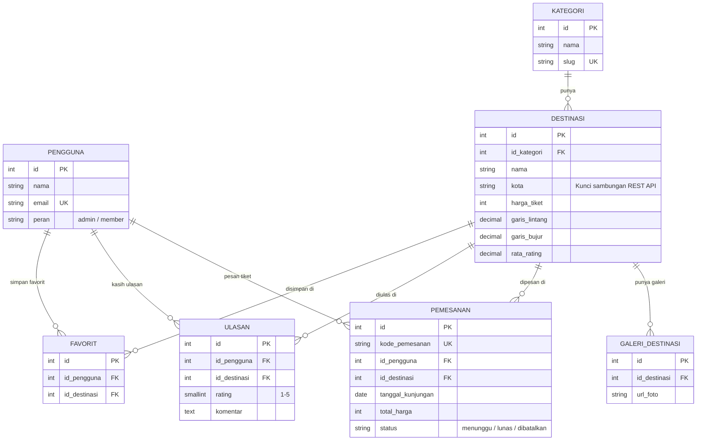

# 🎒 IndWalk — Explore Indonesia Together
**Repo Projek Akhir Kelompok Mata Kuliah Client-Server (CodeIgniter 4 + PostgreSQL)**

<p align="center">
  
</p>

> [!IMPORTANT]
> **KALIAN BACA DULU SEBENTAR INI WOK, SEDIKIT NYA INI BIAR PAHAM APA AJA ISINYA:**  
> Semua yang ada di repo ini (mulai dari nama web, isi tabel database, desain halaman, sampai pembagian tugas) **BUKAN PATOKAN MATI**. Ini sengaja kubuat untuk **pondasi awal** aja biar kita gak mulai dari awal. Kalau ada yang kurang sreg atau mau diubah, langsung ingfokan ke grup (tapi kalo bisa kita bicarakan lewat discord aja biar enak).

---

## 🖥️ Soal Landing Page yang Ada Sekarang
Kalau kalian nengok View, trus kalian ketik ini di cmd/terminal (`php spark serve`), bakal muncul **Landing Page statis**.
- **Kenapa dibuat?** Cuma buat *preview* kasar / gambaran awal aja cam mana bentuk web wisata kita nanti, sekaligus ngetes biar waktu kalian baru *clone* repo ini, webnya langsung bisa dibuka di browser **tanpa harus pusing setting PostgreSQL dulu**.
- **"Anjing burik kali kontol tampilan apa ini modal AI bah!"** Santai ya bujang, desain yang sekarang memang masih sementara. Nanti kita rombak bersamaan dengan hasil diskusi kelompok!

---

## ⚡ Cara Jalanin Projek di Laptop Masing-Masing

```bash
# 1. Clone repo ini (cukup sekali di awal)
git clone <url-repo-github-kita>
cd tugas_akhir_client_server
# Sebenarnya bisa langsung lewat VS Code untuk nge clone dari github tanpa ngetik kode clone ini. Cari di gugel caranya cam mana.

# 2. Copy file env dan ubah .env
cp env .env

# 3. Kalau vendor belum ada / error, jalankan:
composer install

# 4. Nyalakan server lokal
php spark serve
```
Buka **`http://localhost:8080`** di browser. Done!

---

## 🤖 "Kok banyak kali file md beserak kontol"
Karena aku asumsikan di kelompok kita ada yang pakai **Claude Code**, **CODEX**, dan **Antigravity** (ya walaupun aku tau kebanyakan make **Antigravity**), file-file ini sengaja kubuat sebagai **"otak bersama"** buat AI kita. Jadi pas kalian nyuruh AI bikin fitur, AI-nya langsung paham struktur projek kita dan nggak ngarang tabel atau desain sendiri:

| Nama File / Folder | Gunanya Buat Apa Mek? |
| :--- | :--- |
| **[`GOAL.md`](GOAL.md)** | Visi web **IndWalk**, warna brand dari logo, dan trik **Client-Server REST API** (biar web kita tetap aman pakai data simulasi kalau API kelompok lain belum jadi / mati pas demo). |
| **[`PRD.md`](PRD.md)** | Rencana fitur lengkap, daftar route URL, format JSON REST API buat dibagi ke kelompok lain, dan **usulan pembagian tugas 5 orang**. |
| **[`AGENTS.md`](AGENTS.md)** | Instruksi otomatis yang dibaca sama **Antigravity** & **CODEX** waktu kalian ngoding. |
| **[`CLAUDE.md`](CLAUDE.md)** | Instruksi otomatis khusus buat yang pakai **Claude Code**. |
| **[`.agents/`](.agents/)** | Folder berisi rules **`anti-ai-slop.md`** (biar desain UI bikinan AI nggak kelihatan pasaran/kaku) dan **`clean-code-indonesia.md`** (biar semua variabel, array key, & kode memakai Bahasa Indonesia yang gampang kita baca). |

---

## 🇮🇩 Aturan Ngoding Kita: Clean Code Berbahasa Indonesia
Di dalam folder `.agents/rules/clean-code-indonesia.md`, sudah dipasang aturan supaya setiap kali kita nyuruh AI bikin kode:
1. **Nama Variabel & Fungsi Pakai Bahasa Indonesia:** Contohnya `$destinasiUtama`, `$daftarKategori`, `hitungTotalHarga()` (bukan bahasa Inggris yang bikin pusing pas baca).
2. **Array Key & Nama Kolom Database Seragam Bahasa Indonesia:** Contohnya `$destinasi['harga_tiket']`, `$destinasi['garis_lintang']`, `$destinasi['jam_buka']`.
3. **Kodenya Mudah Dibaca (*Clean Code*):** AI dilarang menumpuk logika rumit jadi 1 baris pendek yang susah dimengerti, dan wajib ngasih komentar penjelas berbahasa Indonesia supaya waktu ditanya dosen pas demo/sidang kita semua paham alurnya!

---

## 🗄️ Desain Database (PostgreSQL) & Alur Tabel
Contoh **7 tabel utama (Full Bahasa Indonesia)** sudah ku siapkan di folder **[`app/Database/`](app/Database/)**. Konsepnya simpel:
1. **`pengguna`**: Data akun yang login (`admin` pengelola & `member` wisatawan).
2. **`kategori`**: Kategori wisata (Bahari, Cagar Budaya, Pegunungan, dll).
3. **`destinasi`**: Data tempat wisata. Ada kolom **`kota`** (misal: *Magelang*, *Malang*) yang dipakai buat nyambungin **REST API kelompok lain** (Kuliner, Penginapan, Transportasi) di kota yang sama!
4. **`galeri_destinasi`**: Foto-foto tambahan tiap tempat wisata.
5. **`pemesanan`**: Data pemesanan tiket kunjungan dari member.
6. **`ulasan`**: Rating bintang (1–5) & komentar pengunjung.
7. **`favorit`**: Daftar tempat wisata yang disimpan/di-*bookmark* member.



### Cara Import Database ke PostgreSQL Masing-Masing
Pertama, buat database kosong dulu di PostgreSQL kalian (misal namanya `indwalk_db`), lalu pilih **salah satu** cara paling gampang buat kalian:

#### Cara 1: Lewat Terminal/CMD CI4 (Sekaligus Isi Data Contoh Otomatis)
1. Buka file `.env`, cari bagian database, hapus tanda `#` di depannya, dan sesuaikan:
   ```ini
   database.default.hostname = localhost
   database.default.database = indwalk_db
   database.default.username = postgres
   database.default.password = password_postgres_kalian
   database.default.DBDriver = Postgre
   database.default.port     = 5432
   ```
2. Jalankan perintah ini di terminal/cmd:
   ```bash
   php spark migrate
   php spark db:seed IndWalkSeeder
   ```
   *(Otomatis langsung ke-buat 7 tabel + akun contoh + 6 data destinasi wisata!)*

#### Cara 2: Buat yang MALAS Setting CLI (Langsung via pgAdmin / DBeaver)
1. Buka **pgAdmin** atau **DBeaver**, pilih database `indwalk_db`.
2. Buka Query Tool, lalu *copy-paste* dan *run* isi file **[`app/Database/schema_postgresql.sql`](app/Database/schema_postgresql.sql)**. Langsung jadi ke-7 tabelnya!

---

## 🌿 Cheat Sheet Git Simpel (Biar Nggak Bentrok / Conflict Pas Push!)

Karena kita kerja **berlima**, ikuti **3 tips ini ya coy**  biar kode kita nggak ketimpa:

### 1. Selalu `git pull` Dulu SEBELUM Mulai Ngoding!
Jangan langsung ngoding dulu ya bujang. Tarik dulu update terbaru dari kawan yang lain:
```bash
git pull origin main
```

### 2. Pake Branch Sendiri (cari di gugel apa itu Branch)
Jangan keroyokan ngoding langsung di branch `main`. Bikin branch pakai namamu atau fiturmu:
```bash
# Bikin & pindah ke branch baru (cukup sekali pas mulai fitur)
git checkout -b fitur-booking

# Cek file apa aja yang kau ubah
git status

# Simpan & push ke GitHub
git add .
git commit -m "bikin halaman booking tiket"
git push origin fitur-booking
```
*(Habis itu tinggal digabung / Merge lewat Pull Request di GitHub).*

### 3. Kalau Mau Push Langsung ke `main`, Wajib Urutan Ini:
```bash
git add .
git commit -m "pesan commit singkat dan jelas"
git pull origin main   # <-- WAJIB tarik dulu sebelum push!
git push origin main
```
> 🚫 **Ingat ini mek:** Jangan pernah pake `git push -f` (*force push*) ke `main` karena itu bakal menghapus kerjaan kawan yang sudah masuk duluan!
