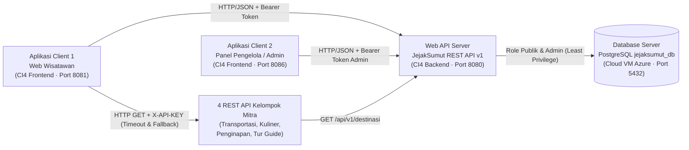
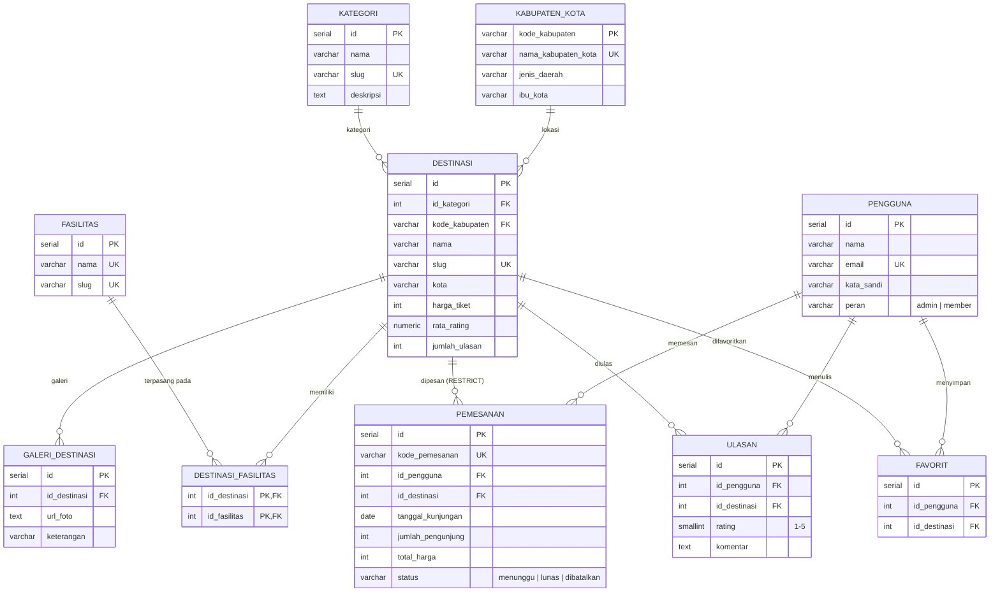

# JejakSumut — Platform Direktori, Pemesanan Tiket & Ekosistem Wisata Sumatera Utara

Proyek Akhir Mata Kuliah **Manajemen Database Client Server (`PLMKB502`)**  
Program Studi D-4 Teknologi Rekayasa Perangkat Lunak — Politeknik Negeri Medan  
Dosen Penguji: **Donny Sanjaya, M.Kom.**

---

## 1. Gambaran Umum & Pembagian Modul Kelompok

**JejakSumut** adalah sistem berbasis arsitektur **Client-Server terpisah** untuk eksplorasi destinasi wisata di Provinsi Sumatera Utara (615+ objek wisata berkoordinat GPS di 33 kabupaten/kota), pemesanan E-Ticket elektronik, ulasan wisatawan, pengelolaan destinasi oleh administrator, serta integrasi lintas-layanan melalui REST API dengan 4 kelompok mitra (Transportasi, Kuliner, Penginapan, dan Tur Guide).

| Modul | Fokus Utama | Direktori / Komponen Kunci |
| :--- | :--- | :--- |
| **Anggota 1** | Beranda, Katalog Eksplorasi & Detail Destinasi | `DestinasiApiController`, `KategoriApiController`, `Home`, `DestinasiController` |
| **Anggota 2** | Integrasi Client-Server & 4 REST API Kelompok Mitra | `LayananApiBackend`, `LayananApiMitra`, `MitraTransportController`, `rekomendasi_mitra.php` |
| **Anggota 3** | Autentikasi Token HMAC, RBAC, Sesi & Favorit | `AutentikasiApiController`, `FavoritApiController`, `AutentikasiTokenFilter`, `PeranAdminFilter`, `AutentikasiController` |
| **Anggota 4** | Transaksi Pemesanan Tiket (ACID), E-Ticket & Ulasan | `PemesananApiController`, `UlasanApiController`, `PemesananModel`, `UlasanModel`, `PemesananController` |
| **Anggota 5** | Perancangan DB, Objek DB (View/SP/Trigger) & Panel Pengelola | `Migrations/`, `schema_postgresql.sql`, `setup_hak_akses_k2.sql`, `AdminApiController`, `DestinasiAdminApiController`, `Controllers/Admin/*` |

---

## 2. Arsitektur Sistem Client-Server

Sistem dipisahkan secara tegas menjadi **1 Web API Server (`backend/`)**, **2 Aplikasi Client (`frontend/` dalam mode Wisatawan & mode Pengelola)**, serta **1 Database Server PostgreSQL** terpisah di Cloud VM Azure. Seluruh aplikasi client dilarang mengakses PostgreSQL secara langsung dan wajib berkomunikasi melalui protokol HTTP/JSON.



---

## 3. Perancangan Database PostgreSQL, Normalisasi 3NF & Objek Database (`K1` & `K2`)

Skema database berada pada [`backend/app/Database/schema_postgresql.sql`](backend/app/Database/schema_postgresql.sql) dan dikelola bertahap melalui [`backend/app/Database/Migrations/`](backend/app/Database/Migrations/).

### A. Pemenuhan Bentuk Normal Ketiga (3NF) & Atribut Terkontrol
Seluruh tabel master dan transaksi (`kabupaten_kota`, `pengguna`, `kategori`, `destinasi`, `fasilitas`, `destinasi_fasilitas`, `galeri_destinasi`, `pemesanan`, `ulasan`, `favorit`) memenuhi **3NF** karena setiap atribut bukan kunci bergantung penuh pada Primary Key tanpa ketergantungan transitif.

Beberapa kolom turunan pada tabel `destinasi` dipertahankan secara terkontrol (*intentional denormalization*) demi efisiensi kueri katalog dan keutuhan riwayat:
- `rata_rating` dan `jumlah_ulasan` disinkronkan otomatis di tingkat DBMS oleh trigger `trg_sinkronkan_rating_destinasi` setiap kali baris pada tabel `ulasan` bertambah, berubah, atau dihapus.
- `kota` dan `label_harga_tiket` diselaraskan oleh backend saat penyimpanan data berdasarkan referensi `kabupaten_kota` dan `harga_tiket`.
- `total_harga` pada tabel `pemesanan` disimpan sebagai *snapshot* nilai transaksi saat pembelian agar perubahan harga tiket destinasi di kemudian hari tidak mengubah histori transaksi lama.

### B. Ringkasan Tabel, Indeks, Constraint & Objek Database
- **10 Tabel Utama**: `kabupaten_kota`, `pengguna`, `kategori`, `destinasi`, `fasilitas`, `destinasi_fasilitas`, `galeri_destinasi`, `pemesanan`, `ulasan`, `favorit`.
- **Constraint Integritas**: `PRIMARY KEY`, `FOREIGN KEY` (`ON DELETE RESTRICT` pada `pemesanan.id_destinasi` untuk melindungi riwayat transaksi, `ON DELETE CASCADE` pada relasi galeri/fasilitas/ulasan/favorit), `UNIQUE` (`email`, `slug`, `kode_pemesanan`, pasangan `(id_pengguna, id_destinasi)`), dan `CHECK` (`peran`, `harga_tiket >= 0`, `jumlah_pengunjung >= 1`, `total_harga >= 0`, `status`, `rating BETWEEN 1 AND 5`).
- **Indeks Kueri Utama**: `destinasi_id_kategori`, `destinasi_kode_kabupaten`, `destinasi_kota`, `destinasi_harga_tiket`, `destinasi_rating_ulasan`, `pengguna_email_lower` (`LOWER(email)`), `pemesanan_id_pengguna`, `pemesanan_id_destinasi`, `pemesanan_status_dibuat_pada`, `ulasan_id_pengguna`, `ulasan_id_destinasi`.
- **2 SQL Views**:
  - `v_wisata_lengkap`: gabungan informasi lengkap `destinasi`, `kabupaten_kota`, dan `kategori`.
  - `v_ringkasan_pemesanan`: ringkasan transaksi tiket lengkap bersama nama pemesan dan lokasi tanpa mengekspos `kata_sandi`.
- **2 Stored Functions & 1 Stored Procedure**:
  - `fn_kunci_destinasi_pemesanan(INTEGER)`: mengunci baris harga destinasi (`FOR SHARE`) saat transaksi tiket berlangsung dengan hak akses minimum (`SECURITY DEFINER`).
  - `fn_buat_kode_pemesanan(DATE)`: menghasilkan kode pemesanan unik `JSM-YYYYMMDD-XXX` menggunakan `pg_advisory_xact_lock` untuk mencegah duplikasi kode saat transaksi bersamaan.
  - `sp_verifikasi_pemesanan(INTEGER, VARCHAR)`: mengubah status pemesanan (`lunas`/`dibatalkan`) dengan penguncian baris `FOR UPDATE` dan validasi transisi status.
- **Trigger & Transaksi ACID**:
  - `trg_sinkronkan_rating_destinasi` (`AFTER INSERT OR UPDATE OR DELETE ON ulasan`) dan `trg_*_diperbarui_pada` (`BEFORE UPDATE`).
  - Transaksi ACID (`transBegin`, `transCommit`, `transRollback`) diterapkan pada pembuatan pemesanan, pembatalan/verifikasi status, penyimpanan ulasan, serta penyuntingan & penghapusan destinasi admin.
- **3 Role PostgreSQL *Least Privilege*** ([`setup_hak_akses_k2.sql`](backend/app/Database/setup_hak_akses_k2.sql)):
  - `jejaksumut_app_publik`: baca katalog/view, tulis transaksi `pengguna`, `pemesanan` (tanpa hak `DELETE`), `ulasan`, dan `favorit`.
  - `jejaksumut_app_admin`: CRUD master wisata, `SELECT`/`UPDATE` pada `pemesanan`, `SELECT`/`DELETE` moderasi `ulasan`, tanpa hak DDL.
  - `jejaksumut_mitra_readonly`: hanya `SELECT` pada katalog wisata publik.

### C. Entity Relationship Diagram (ERD)



---

## 4. Spesifikasi REST API v1 & Keamanan (`K3`, `K4`, `K5`)

Seluruh endpoint mengembalikan payload JSON dengan struktur seragam: `status` (`"berhasil"` / `"gagal"`), `pesan`, dan `data`, dengan kode status HTTP yang sesuai (`200`, `201`, `400`, `401`, `403`, `404`, `409`, `422`, `429`).

| Kelompok Endpoint | Metode & Rute | Otorisasi | Kegunaan Utama |
| :--- | :--- | :--- | :--- |
| **Kesehatan Layanan** | `GET /` | Publik | Status koneksi PostgreSQL & ringkasan jumlah data |
| **Katalog Publik** | `GET /api/v1/destinasi` | Publik | Daftar destinasi dengan filter, paginasi, atau batch `?daftar_slug=` |
| | `GET /api/v1/destinasi/{slug_atau_id}` | Publik | Detail lengkap 1 destinasi, fasilitas, galeri & 20 ulasan terbaru |
| | `GET /api/v1/kategori`, `GET /api/v1/kabupaten-kota` | Publik | Daftar kategori dan 33 kabupaten/kota Sumatera Utara |
| | `GET /api/v1/ulasan?id_destinasi={id}` | Publik | Daftar ulasan & rating rata-rata destinasi |
| **Autentikasi** | `POST /api/v1/auth/masuk`, `POST /api/v1/auth/daftar` | Publik (Rate-limited) | Login (token HMAC 24 jam) & registrasi member baru |
| | `POST /api/v1/auth/ganti-sandi`, `lupa-sandi`, `reset-sandi` | Token / Rate-limited | Pembaruan & pemulihan kata sandi (otomatis menghanguskan token lama) |
| **Member Terproteksi** | `GET /api/v1/favorit/{id}`, `POST /api/v1/favorit/ubah` | Bearer Token | Daftar, cek status, dan toggle favorit milik akun sendiri |
| | `GET /api/v1/pemesanan`, `GET /api/v1/pemesanan/{id}` | Bearer Token | Riwayat & detail E-Ticket milik akun sendiri |
| | `POST /api/v1/pemesanan`, `PATCH /api/v1/pemesanan/{id}/batal` | Bearer Token | Pemesanan tiket (ACID) & pembatalan status `menunggu` |
| | `POST /api/v1/ulasan` | Bearer Token | Kirim ulasan & rating bintang (1–5) per akun |
| **Panel Pengelola** | `GET /api/v1/admin/statistik`, `pemesanan`, `ulasan` | Bearer Admin (`peranAdmin`) | Statistik pendapatan, antrian verifikasi, moderasi ulasan |
| | `GET /api/v1/admin/destinasi/{id}` | Bearer Admin | Data edit destinasi + hash `versi_data` (SHA-256) |
| | `POST /api/v1/destinasi`, `PUT /api/v1/destinasi/{id}`, `DELETE /api/v1/destinasi/{id}` | Bearer Admin | CRUD destinasi dengan optimistic locking (`409` bila konflik versi/relasi) |
| | `PATCH /api/v1/pemesanan/{id}/status`, `DELETE /api/v1/ulasan/{id}` | Bearer Admin | Verifikasi pembayaran (`sp_verifikasi_pemesanan`) & hapus ulasan |

**Kontrol Keamanan Utama:**
- Token Bearer ditandatangani dengan **HMAC-SHA256** (berlaku 24 jam) dan terikat pada sidik hash kata sandi pengguna sehingga otomatis hangus apabila kata sandi diganti atau di-reset.
- Filter **`AutentikasiTokenFilter`** (`401`) dan **`PeranAdminFilter`** (`403`) memvalidasi ulang keberadaan akun, sidik kata sandi, dan peran admin langsung ke PostgreSQL pada tiap permintaan.
- Seluruh kueri menggunakan Query Builder / *parameterized binding* (`?`) untuk mencegah SQL Injection, form web dilindungi **CSRF token** (termasuk proses keluar akun via `POST`), output View dibungkus `esc()`, serta respons API & Web dilengkapi `HeaderKeamananFilter` (`HSTS`, `CSP`, `X-Frame-Options`, `X-Content-Type-Options`, `Referrer-Policy`, dan penghapusan `X-Powered-By`).
- Pembatasan laju permintaan (*Rate Limiting*) aktif pada autentikasi (`masuk`, `daftar`, `ganti-sandi`, `lupa-sandi`, `reset-sandi`) dan seluruh endpoint terproteksi (`60 req/menit`).

---

## 5. Panduan Instalasi & Menjalankan Dua Aplikasi Client (`K6`)

### Prasyarat
- PHP 8.2+ dengan ekstensi `pgsql`, `curl`, `intl`, `mbstring`, `json`
- Composer
- PostgreSQL 14+ (tersambung ke Cloud VM Azure atau instance lokal terpisah)

### Langkah Setup Awal
1. Pasang dependensi Composer pada masing-masing aplikasi:
   ```bash
   cd backend && composer install
   cd ../frontend && composer install
   ```
2. Salin template konfigurasi lingkungan:
   ```bash
   cp backend/env backend/.env
   cp frontend/env frontend/.env
   ```
3. Konfigurasikan `backend/.env`:
   - Isi koneksi PostgreSQL (`database.default.hostname`, `database`, `username`, `password`, `DBDriver = Postgre`, `port = 5432`).
   - Isi `JEJAKSUMUT_KUNCI_TOKEN` dengan kunci acak minimal 32 karakter (misal hasil `openssl rand -hex 32`).
   - Opsional untuk produksi: atur `CI_ENVIRONMENT = production`, `JEJAKSUMUT_DB_ENCRYPT = true`, serta `JEJAKSUMUT_DB_ADMIN_USER` & `JEJAKSUMUT_DB_ADMIN_PASSWORD` sesuai role pada [`setup_hak_akses_k2.sql`](backend/app/Database/setup_hak_akses_k2.sql).
4. Jalankan migrasi & seeder pada database baru (lewati langkah seeder apabila memakai database bersama yang sudah terisi):
   ```bash
   cd backend
   php spark migrate
   # Hanya untuk inisialisasi database baru:
   JEJAKSUMUT_KATA_SANDI_ADMIN_AWAL="GantiSandiAdminYangKuat16" php spark db:seed MainSeeder
   ```
   Untuk menerapkan hak akses *least privilege* pada PostgreSQL:
   ```bash
   psql -U postgres -d jejaksumut_db -f backend/app/Database/setup_hak_akses_k2.sql
   ```

### Menjalankan Server API dan Dua Aplikasi Client Secara Bersamaan
Buka 3 terminal terpisah dari direktori proyek:

1. **Web API Server (`backend/`) — Port `8080`**:
   ```bash
   cd backend
   env CI_ENVIRONMENT=production app_baseURL=http://localhost:8080/ \
     JEJAKSUMUT_FRONTEND_URL=http://localhost:8081 \
     php spark serve --port 8080
   ```
2. **Aplikasi Client 1: Web Wisatawan (`frontend/`) — Port `8081`**:
   ```bash
   cd frontend
   env CI_ENVIRONMENT=production app_baseURL=http://localhost:8081/ \
     JEJAKSUMUT_MODE_CLIENT=wisatawan \
     JEJAKSUMUT_BACKEND_API_URL=http://localhost:8080/api/v1 \
     JEJAKSUMUT_PANEL_ADMIN_URL=http://localhost:8086/admin \
     php spark serve --port 8081
   ```
3. **Aplikasi Client 2: Panel Pengelola (`frontend/`) — Port `8086`**:
   ```bash
   cd frontend
   env CI_ENVIRONMENT=production app_baseURL=http://localhost:8086/ \
     JEJAKSUMUT_MODE_CLIENT=admin \
     JEJAKSUMUT_BACKEND_API_URL=http://localhost:8080/api/v1 \
     session_cookieName=jejaksumut_admin \
     security_cookieName=jejaksumut_admin_csrf \
     php spark serve --port 8086
   ```

---

## 6. Panduan Pengujian & Demo Teknis (`K7` & `K9`)

### A. Demo Konkurensi & Konsistensi Data Lintas Client (`K7`)
1. **Sinkronisasi Lintas Aplikasi**: Pesan tiket wisata dari Client 1 (`http://localhost:8081`), lalu buka menu **Pemesanan** pada Client 2 (`http://localhost:8086/admin`) dan klik **Verifikasi lunas**. Muat ulang E-Ticket di Client 1 — status otomatis berubah menjadi **Terverifikasi · Lunas**.
2. **Perlindungan Konflik Edit (*Optimistic Locking* + `FOR UPDATE`)**:
   - Buka form edit destinasi yang sama (`GET /api/v1/admin/destinasi/{id}`) pada dua jendela browser Admin terpisah (misal normal & incognito). Keduanya menerima `versi_data` SHA-256 yang sama.
   - Simpan perubahan pada browser pertama (`200 OK`, `versi_data` diperbarui).
   - Simpan perubahan pada browser kedua dengan `versi_data` lama: backend mengunci baris dengan `SELECT ... FOR UPDATE`, mendeteksi ketidakcocokan `versi_data`, lalu menolak dengan `409 Conflict` (`data.konflik = "versi_data"`). Panel Admin menampilkan pesan konflik sambil mempertahankan isian untuk disalin dan menyediakan tautan **Muat data terbaru**.

### B. Pengujian Otomatis (PHPUnit) & Koleksi Postman
- **Unit Test Dasar**:
  ```bash
  cd backend && php vendor/bin/phpunit --no-coverage tests/unit/HealthTest.php
  cd frontend && php vendor/bin/phpunit --no-coverage tests/unit/HealthTest.php
  ```
- **Uji Integrasi Konkurensi (`KonflikDestinasiTest.php`)** pada database pengujian terpisah:
  ```bash
  cd backend
  JEJAKSUMUT_UJI_API_URL=http://localhost:8080/api/v1 \
  JEJAKSUMUT_UJI_TOKEN_ADMIN="<token_admin_uji>" \
  php vendor/bin/phpunit --no-coverage tests/integration/KonflikDestinasiTest.php
  ```
- **Koleksi Postman**: Impor [`postman/JejakSumut_API.postman_collection.json`](postman/JejakSumut_API.postman_collection.json) beserta environment [`JejakSumut_Lokal.postman_environment.json`](postman/JejakSumut_Lokal.postman_environment.json) atau [`JejakSumut_VM_Azure.postman_environment.json`](postman/JejakSumut_VM_Azure.postman_environment.json). Folder `01` hingga `06` sudah mencakup seluruh skenario **Checklist Demo Teknis** (`401`, `403`, `409` konflik versi & relasi `RESTRICT`, `422`, dan uji SQL Injection). Informasi konsumsi API bagi 4 kelompok mitra tersedia di [`postman/PANDUAN_API_MITRA.md`](postman/PANDUAN_API_MITRA.md).
